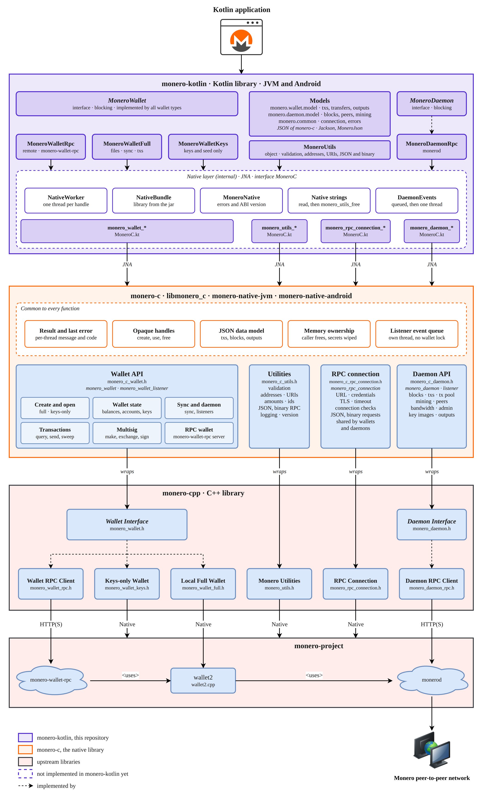

# Monero Kotlin Library

[](https://github.com/libmonero/monero-kotlin/actions/workflows/build.yml)
[](https://github.com/libmonero/monero-kotlin/actions/workflows/native.yml)
[](https://github.com/libmonero/monero-kotlin/actions/workflows/android.yml)

[](https://github.com/libmonero/monero-kotlin/actions/workflows/unit-tests.yml)
[](https://github.com/libmonero/monero-kotlin/actions/workflows/integration-tests.yml)
[](https://app.codacy.com/gh/libmonero/monero-kotlin/dashboard?utm_source=gh&utm_medium=referral&utm_content=&utm_campaign=Badge_grade)
[](https://app.codacy.com/gh/libmonero/monero-kotlin/dashboard?utm_source=gh&utm_medium=referral&utm_content=&utm_campaign=Badge_coverage)

[](https://kotlinlang.org/)
[](https://adoptium.net/)

[![License](https://img.shields.io/badge/license-MIT-green?logo=data:image/svg%2Bxml;base64,PHN2ZyBmaWxsPSIjZmZmIiB4bWxucz0iaHR0cDovL3d3dy53My5vcmcvMjAwMC9zdmciIHdpZHRoPSIxNiIgaGVpZ2h0PSIxNiIgdmlld0JveD0iMCAwIDE2IDE2Ij48cGF0aCBkPSJNOC43NS43NVYyaC45ODVjLjMwNCAwIC42MDMuMDguODY3LjIzMWwxLjI5LjczNmMuMDM4LjAyMi4wOC4wMzMuMTI0LjAzM2gyLjIzNGEuNzUuNzUgMCAwIDEgMCAxLjVoLS40MjdsMi4xMTEgNC42OTJhLjc1Ljc1IDAgMCAxLS4xNTQuODM4bC0uNTMtLjUzLjUyOS41MzEtLjAwMS4wMDItLjAwMi4wMDItLjAwNi4wMDYtLjAwNi4wMDUtLjAxLjAxLS4wNDUuMDRjLS4yMS4xNzYtLjQ0MS4zMjctLjY4Ni40NUMxNC41NTYgMTAuNzggMTMuODggMTEgMTMgMTFhNC40OTggNC40OTggMCAwIDEtMi4wMjMtLjQ1NCAzLjU0NCAzLjU0NCAwIDAgMS0uNjg2LS40NWwtLjA0NS0uMDQtLjAxNi0uMDE1LS4wMDYtLjAwNi0uMDA0LS4wMDR2LS4wMDFhLjc1Ljc1IDAgMCAxLS4xNTQtLjgzOEwxMi4xNzggNC41aC0uMTYyYy0uMzA1IDAtLjYwNC0uMDc5LS44NjgtLjIzMWwtMS4yOS0uNzM2YS4yNDUuMjQ1IDAgMCAwLS4xMjQtLjAzM0g4Ljc1VjEzaDIuNWEuNzUuNzUgMCAwIDEgMCAxLjVoLTYuNWEuNzUuNzUgMCAwIDEgMC0xLjVoMi41VjMuNWgtLjk4NGEuMjQ1LjI0NSAwIDAgMC0uMTI0LjAzM2wtMS4yODkuNzM3Yy0uMjY1LjE1LS41NjQuMjMtLjg2OS4yM2gtLjE2MmwyLjExMiA0LjY5MmEuNzUuNzUgMCAwIDEtLjE1NC44MzhsLS41My0uNTMuNTI5LjUzMS0uMDAxLjAwMi0uMDAyLjAwMi0uMDA2LjAwNi0uMDE2LjAxNS0uMDQ1LjA0Yy0uMjEuMTc2LS40NDEuMzI3LS42ODYuNDVDNC41NTYgMTAuNzggMy44OCAxMSAzIDExYTQuNDk4IDQuNDk4IDAgMCAxLTIuMDIzLS40NTQgMy41NDQgMy41NDQgMCAwIDEtLjY4Ni0uNDVsLS4wNDUtLjA0LS4wMTYtLjAxNS0uMDA2LS4wMDYtLjAwNC0uMDA0di0uMDAxYS43NS43NSAwIDAgMS0uMTU0LS44MzhMMi4xNzggNC41SDEuNzVhLjc1Ljc1IDAgMCAxIDAtMS41aDIuMjM0YS4yNDkuMjQ5IDAgMCAwIC4xMjUtLjAzM2wxLjI4OC0uNzM3Yy4yNjUtLjE1LjU2NC0uMjMuODY5LS4yM2guOTg0Vi43NWEuNzUuNzUgMCAwIDEgMS41IDBabTIuOTQ1IDguNDc3Yy4yODUuMTM1LjcxOC4yNzMgMS4zMDUuMjczczEuMDItLjEzOCAxLjMwNS0uMjczTDEzIDYuMzI3Wm0tMTAgMGMuMjg1LjEzNS43MTguMjczIDEuMzA1LjI3M3MxLjAyLS4xMzggMS4zMDUtLjI3M0wzIDYuMzI3WiIvPjwvc3ZnPg%3D%3D)](https://github.com/libmonero/monero-kotlin/blob/main/LICENSE)

> [!WARNING]
>
> monero-kotlin is under development and unfunded, expect bugs and breaking changes.

A Kotlin library for creating Monero applications using RPC and a C ABI to [monero v0.18.5.4 'Fluorine Fermi'](https://github.com/monero-project/monero/tree/v0.18.5.4).

* Supports a daemon RPC client.
* Supports a keys-only wallet, and a full wallet with its files, sync, transactions and multisig.
* Supports a wallet RPC client for the wallets of a monero-wallet-rpc server.
* Daemon implementations are interchangeable by conforming to a [common interface](src/main/kotlin/monero/daemon/MoneroDaemon.kt).
* Uses a clearly defined [data model and API specification](https://github.com/libmonero/monero-kotlin/blob/main/docs/monero-spec.pdf) intended to be intuitive and robust.
* Fetch and process binary data from the daemon (e.g. raw blocks).
* Receive notifications when blocks are added to the chain.
* Has an [Android module](android/README.md) that packages it with monero-c as an AAR.
* Receive notifications when wallets sync, send, or receive.
* Query wallet transactions, transfers, and outputs by their properties.
* Over 1,000 tests.

## Architecture

<p align="center">
	<br>
	<i>Build Kotlin applications using RPC or the C ABI of <a href="https://github.com/libmonero/monero-c">monero-c</a> to <a href="https://github.com/monero-project/monero">monero-project/monero</a>.  Daemon implementations are interchangeable by conforming to a common interface, <a href="src/main/kotlin/monero/daemon/MoneroDaemon.kt">MoneroDaemon</a>.</i>
</p>

The calls are blocking. The call itself is made by monero-c, and the library runs the calls of a daemon or a wallet one after the other on a thread of its own, so a call does not depend on the thread that makes it. A daemon and a wallet hold a native handle: close them to release it. See [Threads, handles and listeners](docs/threads.md).

## Sample code

### Daemon

```kotlin
// connect to daemon
MoneroDaemonRpc("http://localhost:38081", "superuser", "abctesting123").use { daemon ->
    val height = daemon.getHeight()                              // 1523651
    val txsInPool = daemon.getTxPool()                           // get transactions in the pool

    // get a block and its transactions
    val block = daemon.getBlockByHeight(height - 1)
    val txs = daemon.getTxs(block.txHashes.orEmpty())

    // receive notifications when blocks are added to the chain
    daemon.addListener(object : MoneroDaemonListener() {
        override fun onBlockHeader(header: MoneroBlockHeader) {
            val newHeight = header.height
            val hash = header.hash
        }
    })

    // or wait for the next block
    val header = daemon.waitForNextBlockHeader()
}

// read and write the data model as the JSON of monero-cpp and monero-c
val block = MoneroJson.deserialize<MoneroBlock>(json)
val fee = block.txs?.first()?.fee      // atomic units
val written = MoneroJson.serialize(block)
```

### Wallets

A keys wallet has the keys, the seed and the addresses of an account, and nothing else: no files, no chain, no daemon.

```kotlin
// restore a keys wallet from a seed
val config = MoneroWalletConfig()
config.networkType = MoneroNetworkType.MAINNET
config.seed = seed

MoneroWalletKeys.createWalletFromSeed(config).use { wallet ->
    val primaryAddress = wallet.getPrimaryAddress()
    val subaddress = wallet.getAddress(0, 1)

    // sign a message and verify it
    val signature = wallet.signMessage("hello", MoneroMessageSignatureType.SIGN_WITH_SPEND_KEY, 0, 0)
    val verified = wallet.verifyMessage("hello", primaryAddress, signature).isGood
}
```

A full wallet has its files, syncs with a daemon, and creates and relays transactions. It can also be a multisig wallet. `use` closes the wallet without saving it, so `save()` it first. The connection to the daemon is not in the files, so a wallet that is opened has to be connected again.

```kotlin
// create a wallet with its files, connected to a daemon
val config = MoneroWalletConfig()
config.path = "mywallet"
config.password = "abctesting123"
config.networkType = MoneroNetworkType.STAGENET
config.server = MoneroRpcConnection("http://localhost:38081")

MoneroWalletFull.createWallet(config).use { wallet ->
    wallet.sync()
    val balance = wallet.getBalance()                  // atomic units
    val unlocked = wallet.getUnlockedBalance()

    // create a transaction, and relay it
    val txConfig = MoneroTxConfig()
    txConfig.accountIndex = 0
    txConfig.destinations = listOf(MoneroDestination(address, amount))
    txConfig.relay = false
    val tx = wallet.createTxs(txConfig).first()
    val hash = wallet.relayTx(tx)

    wallet.save()
}

// open it again
MoneroWalletFull.openWallet(config).use { wallet ->
    wallet.setDaemonConnection(MoneroRpcConnection("http://localhost:38081"))
    wallet.sync()
}
```

A wallet RPC client lives on a monero-wallet-rpc server, which keeps the keys, the files and the sync, and has one wallet open at a time. It has no wallet open until it opens or creates one on the server, and `use` closes that wallet on the server. It has the functions of a full wallet, except the few that a server does not support, which throw an error.

```kotlin
// connect to the server, and create a wallet on it
MoneroWalletRpc("http://localhost:28084", "rpc_user", "abc123").use { wallet ->
    val config = MoneroWalletConfig()
    config.path = "mywallet"
    config.password = "abctesting123"
    wallet.createWallet(config)

    wallet.sync()
    val balance = wallet.getBalance()                  // atomic units

    // tag the accounts, which only a wallet of a server can do
    wallet.tagAccounts("savings", listOf(0))
}

// open it again
MoneroWalletRpc("http://localhost:28084", "rpc_user", "abc123").use { wallet ->
    wallet.openWallet("mywallet", "abctesting123")
}
```


A light wallet keeps no chain and no files: a light wallet server scans the chain for its address and answers its questions, so it restores in seconds on a phone. It is made from a seed, from keys, or at random, and it lives in memory: there is nothing to save, and closing it forgets it. The server sees the address, so it is trusted with the privacy of the account the way a remote node is.

A light wallet keeps no chain and no files: a light wallet server scans the chain for its address and answers its questions, so it restores in seconds on a phone. It is made from a seed, from keys, or at random, and it lives in memory: there is nothing to save, and closing it forgets it. The server holds the private view key of the account, so it reads its whole history: it is trusted with more than a remote node, which is why it is self-hosted.

A light wallet keeps no chain and no files: a light wallet server scans the chain for its address and answers its questions, so it needs no scan of its own. It is made from a seed, from keys, or at random, and it lives in memory: there is nothing to save, and closing it throws it away. The server holds the private view key of the account, so it reads its whole history: it is trusted with more than a remote node, which is why it is self-hosted.

```kotlin
// create a light wallet on a monero-lws server
val config = MoneroWalletConfig()
config.networkType = MoneroNetworkType.MAINNET
config.seed = seed
val connection = MoneroRpcConnection("http://localhost:8443")

MoneroWalletLight.createWallet(config, connection).use { wallet ->
    wallet.sync()
    val balance = wallet.getBalance()              // atomic units
    val address = wallet.getPrimaryAddress()
}

// open it again: the server knows the address
MoneroWalletLight.openWallet(config, connection).use { wallet ->
    wallet.sync()
    val unrefined = wallet.getUnrefinedSpendCount()   // spends the last sync could not verify
}
```

A monero-lws server to try it against is the compose of the integration tests, which stands one up behind a regtest node (its header says the node starts first on a slow host):

```
docker compose -f src/test/integration/docker-compose.yml up -d
```

## Documentation

* [Data model and API specification](docs/monero-spec.pdf)
* [Data model](docs/data-model.md): types, errors, JSON, queries, merging and the differences from monero-java
* [Threads, handles and listeners](docs/threads.md)
* [Native library](docs/native-library.md): how monero-c is loaded
* [Building](docs/building.md)
* [Testing](docs/testing.md)
* [Continuous integration](docs/continuous-integration.md)
* [Android](android/README.md)
* [Unit tests](src/test/kotlin)
* [monero-java Javadoc](https://woodser.github.io/monero-java/javadocs/index.html) and [monero-ts documentation](https://github.com/woodser/monero-ts#documentation) provide additional documentation which translates to monero-kotlin

## Using monero-kotlin in your project

monero-kotlin is not published to a repository yet. [Build it from source](docs/building.md) and publish it to the local repository of Maven, which Gradle reads:

```sh
./gradlew publishToMavenLocal
```

```kotlin
repositories {
    mavenLocal()
}

dependencies {
    implementation("org.libmonero:monero-kotlin:0.1.0-SNAPSHOT")
}
```

The POM has the dependencies of the library (Jackson and JNA). The shared library of monero-c has to be loadable too, see [Native library](docs/native-library.md).

For Android there is an AAR with the native library in it, see [android/README.md](android/README.md).

You can also add the jar from `build/libs` to your project, with its dependencies:

```kotlin
dependencies {
    implementation(files("libs/monero-kotlin-0.1.0-SNAPSHOT.jar"))
    implementation("com.fasterxml.jackson.core:jackson-databind:2.17.2")
    implementation("net.java.dev.jna:jna:5.15.0")
}
```

You need a daemon to connect to:

1. Download and install [Monero CLI](https://web.getmonero.org/downloads/).
2. Start monerod, e.g.: `./monerod --stagenet` (or use a remote daemon).

## Running tests

```sh
./gradlew test
MONERO_C_LIBRARY=/path/to/libmonero_c.so ./gradlew test --rerun
```

The integration tests need monero-c and the regtest nodes and wallet RPC servers of [src/test/docker/docker-compose.yml](src/test/docker/docker-compose.yml). See [Testing](docs/testing.md) for them, for the logs and for the coverage.

## Related projects

* [monero-c](https://github.com/libmonero/monero-c)
* [monero-cpp](https://github.com/woodser/monero-cpp)
* [monero-csharp](https://github.com/libmonero/monero-csharp)
* [monero-python](https://github.com/libmonero/monero-python)
* [monero-java](https://github.com/woodser/monero-java)
* [monero-ts](https://github.com/woodser/monero-ts)

## License

This project is licensed under MIT.

## Donations

If this library has been valuable to you, please consider donating to support its continued development. 🙏

<p align="center">
  <code>XMR</code><br>
  <br>
  <code>84DG2VwzuVjfmFS6vzfXmNdSGFSrsy922iuwntcCdLMcYe1tmUcsobz9ossuhCQT1YW3tTUFV2eUEAdgT9ANWaquPVeXZNE</code>
</p>
